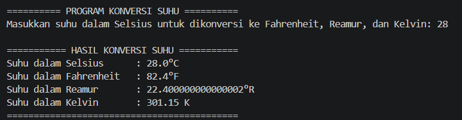

### :thermometer: PROGRAM KONVERSI SUHU :snake:

---
Program berbasis terminal yang ditulis menggunakan bahasa **Python** untuk mengonversi nilai suhu dari satuan **Celcius (°C)** ke dalam tiga satuan suhu lainnya: **Fahrenheit (°F)**, **Reamur (°R)**, dan **Kelvin (K)** secara cepat dan akurat.

---
#### :gear: Cara Menjalankan Program
Pastikan komputer Anda sudah terinstal Python 3.8 atau yang lebih baru (dikembangkan menggunakan Python 3.12). Untuk menjalankan program ini, silahkan ikuti panduan berikut ini:

1. **Unduh kode program:**
```bash
git clone https://github.com/ardipuji/konversi-suhu.git
```

2. **Masuk ke folder proyek:**
```bash
cd konversi-suhu
```

3. **Jalankan program:**
```bash
python konversi_suhu.py
```
atau
```bash
py konversi_suhu.py
```
---
#### :camera_flash: Preview



---
#### :man_technologist: Author

Dikembangkan oleh **Ardi**

- :email: **Email:** [hardipuji19@email.com](mailto:hardipuji19@email.com)
- :link: **GitHub:** [@ardipuji](https://github.com/ardipuji)

---
*Terbuka untuk saran, masukan, maupun peluang kolaborasi!*
